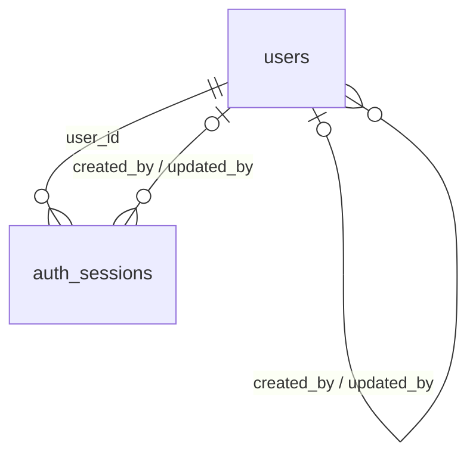

# Identity & Session Schema

M5A provides the PostgreSQL 17 database foundation for Module B: global user identities and their authentication sessions. The SQL migrations are available; applying them is an explicit operation against a verified target. M5B adds login, opaque bearer authentication and current-user retrieval using these tables; M5C adds current/all session revocation. Registration, JWT and session-list/device-management APIs remain unimplemented. Membership/RBAC schema is described in the [separate contract](tenant-membership-rbac-schema.md). See the [authentication contract](../api/authentication.md).

## Identity and tenancy boundary

`users` represents an account, not an employee. One global user may later have memberships in several tenants. Neither table contains `tenant_id`, company, organization or branch identity. Tenant membership alone grants no authorization; role assignments and permissions are separate concerns in the [membership/RBAC schema](tenant-membership-rbac-schema.md). No tenant, employee, membership, role or audit-log table is created here.



The actor edges are optional references to an existing user; they do not grant permissions.

## users

| Column | PostgreSQL type | Nullable | Default / constraint |
|---|---|---|---|
| `id` | UUID | No | Primary key; `gen_random_uuid()` |
| `email` | VARCHAR(255) | No | Globally unique through normalized expression index |
| `password_hash` | TEXT | Yes | None; hash only |
| `display_name` | VARCHAR(150) | No | None |
| `email_verified_at` | TIMESTAMPTZ | Yes | None |
| `last_login_at` | TIMESTAMPTZ | Yes | None |
| `is_active` | BOOLEAN | No | **No default**; account writer must explicitly choose true/false |
| `created_at` | TIMESTAMPTZ | No | `CURRENT_TIMESTAMP` |
| `created_by` | UUID | Yes | FK `users_created_by_fkey` → `users.id` |
| `updated_at` | TIMESTAMPTZ | No | `CURRENT_TIMESTAMP` |
| `updated_by` | UUID | Yes | FK `users_updated_by_fkey` → `users.id` |

The primary key creates `users_pkey`. The only email index is:

```sql
CREATE UNIQUE INDEX users_email_normalized_uidx ON users (lower(btrim(email)));
```

Identity comparison trims ordinary leading/trailing space characters (U+0020) and lowercases according to the database locale. For example, ` Example@Mapatu.test ` conflicts with `example@mapatu.test`, on both insert and update. The supplied text is preserved; future email lookup must use the same expression for matching/index use. There is no separate raw-email unique index, `citext`, extension or normalization trigger. M5B validates login email syntax and bounds at its HTTP boundary; the index itself is not an email validator. Unicode/IDNA and provider-specific canonicalization remain deferred. No provider dot/plus-address rewriting is performed.

## auth_sessions

| Column | PostgreSQL type | Nullable | Default / constraint |
|---|---|---|---|
| `id` | UUID | No | Primary key; `gen_random_uuid()` |
| `user_id` | UUID | No | FK `auth_sessions_user_id_fkey` → `users.id` |
| `token_hash` | TEXT | No | None; hash only |
| `device_name` | VARCHAR(150) | Yes | None |
| `ip_address` | INET | Yes | None; native IPv4/IPv6 |
| `user_agent` | TEXT | Yes | None |
| `expires_at` | TIMESTAMPTZ | No | None; writer supplies expiration |
| `revoked_at` | TIMESTAMPTZ | Yes | None |
| `last_used_at` | TIMESTAMPTZ | Yes | None |
| `created_at` | TIMESTAMPTZ | No | `CURRENT_TIMESTAMP` |
| `created_by` | UUID | Yes | FK `auth_sessions_created_by_fkey` → `users.id` |
| `updated_at` | TIMESTAMPTZ | No | `CURRENT_TIMESTAMP` |
| `updated_by` | UUID | Yes | FK `auth_sessions_updated_by_fkey` → `users.id` |

The primary key creates `auth_sessions_pkey`. Nonunique B-tree `auth_sessions_user_id_idx` supports per-user session lookup; multiple sessions per user are allowed. There is no `is_active`, `status`, `deleted_at` or separate refresh-token table. Future validity depends on expiration, revocation and user activation, followed by membership/authorization checks when available. M5B middleware now performs the session expiry/revocation and active-user checks; tenant authorization remains separate.

## Integrity, audit and write responsibility

Both UUID primary keys use PostgreSQL 17's built-in `gen_random_uuid()`; a writer can also supply an explicit UUID. No additional extension is needed. See [PostgreSQL 17 UUID functions](https://www.postgresql.org/docs/17/functions-uuid.html).

All five FKs are immediate/nondeferrable and use `ON UPDATE NO ACTION ON DELETE NO ACTION`. Invalid non-null actor/user IDs are rejected. Existing users referenced by other users or sessions cannot be deleted while those references remain. No cascade erases sessions, and no automatic actor nulling removes attribution. Hard deletion, session retention, anonymization and cleanup policy remain future decisions; this schema is intentionally conservative.

Audit actors may be null for bootstrap/system writes. `created_at` and initial `updated_at` default to transaction-time `CURRENT_TIMESTAMP`; explicit timestamps remain possible. PostgreSQL does **not** refresh `updated_at` after changes. Future writers must set it deliberately on each update, together with the appropriate actor. There is no trigger. M5B explicitly maintains the user audit/login timestamps and session audit timestamps in the login transaction; other future writers must do the same. All audit/lifecycle timestamps are TIMESTAMPTZ; runtime/migrator connections request UTC, while PostgreSQL display follows the session timezone.

M5A supplies four indexes across these two tables: two primary-key indexes, one normalized-email unique index and one per-user session index. M5B migration000003 adds unique B-tree `auth_sessions_token_hash_uidx` on `token_hash`, for five total indexes and unambiguous indexed bearer lookup. Nullable actor indexes are deferred because there is no actor lookup or user hard-deletion workflow yet; FK enforcement can scan referencing rows. Reassess before such workloads. M5B stores lowercase hex SHA-256 of the issued high-entropy token; the added unique index enforces one session per verifier. Expiration and revocation indexes still depend on actual lifecycle/cleanup queries. No speculative index is added. PostgreSQL expression uniqueness is described in [Indexes on expressions](https://www.postgresql.org/docs/17/indexes-expressional.html).

`password_hash` and `token_hash` are storage contracts, not database-enforced proofs that a value is a cryptographic hash. Never write plaintext passwords or bearer tokens. M5B implements Argon2id password verification and secure opaque-token generation/hash-only session writes; local provisioning is available through the [CLI](../cli.md#4-development-seeding-and-administrator-bootstrap). Parameter and transport details are in the [authentication contract](../api/authentication.md). A null password hash must not authorize passwordless login: M5B rejects accounts without a supported password hash. Keep both hashes out of future JSON responses and logs.

## Migration and verification

| Version | Up | Down |
|---|---|---|
| 000001 | [Create users](../../migrations/postgres/000001_create_users.up.sql) | [Drop users](../../migrations/postgres/000001_create_users.down.sql) |
| 000002 | [Create auth_sessions](../../migrations/postgres/000002_create_auth_sessions.up.sql) | [Drop auth_sessions](../../migrations/postgres/000002_create_auth_sessions.down.sql) |
| 000003 | [Unique token hash index](../../migrations/postgres/000003_index_session_token_hash.up.sql) | [Drop only token hash index](../../migrations/postgres/000003_index_session_token_hash.down.sql) |

Users must be created first; its actor FKs reference the table itself. Sessions follow. Each M5A down file drops only the table from its matching up file, without CASCADE. From version3, one `migrate down` removes only the token-hash index and returns to2, preserving both tables/data. From version 2, one `migrate down` removes sessions and leaves users at version 1; a second removes users and returns to none. Rollback deletes the corresponding table's data and requires an explicitly verified target and recovery plan. Never use down/force on development data as a demonstration.

From the repository root, after checking the effective `DB_*`/JSON target (process > `.env` > JSON > defaults):

```bash
docker compose up -d
go run main.go migrate up
go run main.go migrate version
```

Compose uses `POSTGRES_*`; the Go CLI uses the backend loader and does not infer its target from those variables. `version` may initialize metadata; it is not guaranteed read-only. HTTP startup never applies migrations. See the [CLI migration reference](../cli.md#3-postgresql-migration-commands) for dirty-state recovery, transaction/time bounds and command semantics.

The opt-in [identity schema integration test](../../internal/infrastructure/migration/identity_schema_integration_test.go) uses the actual CLI and copies of the original M5A versions000001/000002 on a random database created by that test, preserving M5A lifecycle assertions as later versions are added. It checks ownership/OID before exact-name cleanup; development-target access is a catalog SELECT in a read-only transaction. It verifies exact columns/indexes, positive/negative constraints, two down steps, unrelated-object preservation, reapply and cleanup:

```bash
go build -o /private/tmp/hris-m5a-backend .
M5A_INTEGRATION=1 M5A_CLI_BINARY=/private/tmp/hris-m5a-backend go test -count=1 -run '^TestIdentitySessionSchemaIntegration$' -v ./internal/infrastructure/migration
```

This requires local PostgreSQL 17 and a role permitted to create disposable databases. It never applies schema or migration metadata to the configured development database. Verification evidence and actual environment status belong in the [M5A review](../../develop/reviews/identity/session-schema/M5A-01-review.md).

## Deferred work

M5B consumes this schema through concrete GORM persistence and consumed identity models; see the [authentication contract](../api/authentication.md). Migration000003 is additive and leaves the original M5A SQL unchanged. Existing duplicate token hashes will make its unique-index creation fail: inspect and remediate under an approved data plan, never automatically delete sessions or force metadata past the failure.

M5C logout/logout-all update revoked_at/updated_at/updated_by without deleting rows or changing schema. User-row locking serializes revocation with session creation; caller-state rechecks use fresh database time after waits. See the [authentication contract](../api/authentication.md). Renewal/refresh, session listing/device management and retention/cleanup remain deferred. Login-abuse controls are active through process-local IP and database-normalized identifier admission; shared multi-instance protection remains deployment-dependent. Alternative authentication providers, production account provisioning, broader email canonicalization and data-retention/index policies remain separately scoped. Membership/RBAC has a separate [schema contract](tenant-membership-rbac-schema.md); employee identity and cross-module audit logs remain deferred.

## Organizational schema boundary

[Module A tenancy/organization](tenancy-organization-schema.md) adds separate tables in versions000004–000009. Their nullable audit actors reference global users without granting membership or permission. They do not change identity/session fields or auth contracts; rollback through Module A stops at version3 and preserves identity tables and the token-hash index.
